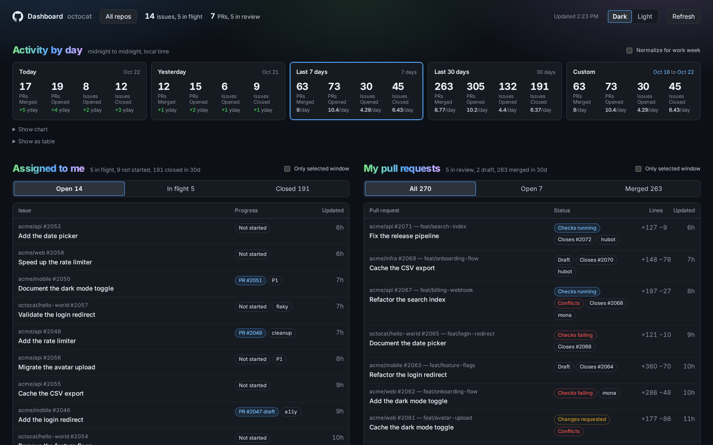

# github-dashboard

Local dashboard of your own GitHub activity: assigned issues, open PRs, the team's code-review and QA queues, and per-day opened/merged counts.

Nothing personal is committed: tokens, sessions, and cached activity live in the gitignored `cache/` folder. Anyone who clones this sees their own account (via `gh auth token` on their machine) or signs in with theirs.

## Run

    ./start.sh            # starts the server if needed, opens http://localhost:4747

Needs Node 22.12 or newer (the tests `require()` the server's ES modules). Tests: `npm test`.

You are signed in automatically on this Mac via `gh auth token`.

To keep it running across reboots and crashes, run `./scripts/install-launchd.sh` once. It starts the server at login and restarts it if it exits. Logs go to `server.log`.

## Share with others

Others sign in with their own GitHub account and see their own numbers. Their token is stored in `cache/sessions.json` on this machine (mode 600).

1. Put the server on the network: `HOST=0.0.0.0 ./start.sh`, then share `http://<your-lan-ip>:4747`.
2. Pick a sign-in method:
   - **Pasted token** (works now): they create a classic PAT with `repo` + `read:org` and paste it on the sign-in screen.
   - **One-click "Sign in with GitHub"**: create an OAuth App at github.com/settings/developers, tick *Enable Device Flow*, then put `GITHUB_CLIENT_ID=<client id>` in a `.env` file next to `start.sh`. No client secret is needed for device flow.

Only the owner session (localhost with `gh`) sees the "Cloned on this Mac" repo group; guests see repos from their own activity.

## Live refresh from Cadence (optional, TrainerRoad only)

Cadence streams every GitHub webhook the org receives at `https://cadence.trainerroad.com/api/webhooks/feed`. With a key, the dashboard follows that stream and refreshes the moment an issue or PR you touch changes, instead of waiting for the 2- and 5-minute polls. A green **Live** badge in the header shows the feed is connected; hover it for the current state.

1. Sign in to Cadence and mint a key at **Settings → Feed Keys** (`/settings/feed-keys`). Give this dashboard its own key; a key shared with another tool gets its stream displaced.
2. Put `CADENCE_FEED_KEY=cdnf.<id>.<secret>` in `.env` next to `start.sh` and restart the server.

The feed is an invalidation signal, never the source of truth: a delivery naming your login marks today and yesterday for refetch and tells the open pages to refetch. Every reconnect refetches once too, because the feed has no replay. Revoking the key on Cadence turns the badge to **Feed down** within five minutes and the dashboard falls back to polling. `CADENCE_FEED_URL` overrides the endpoint for a staging Cadence.

## AI quotas (optional, owner only)

If [cpa-route](https://github.com/KWedey/dev-environment) is installed, a row at the top shows each Claude account's 5-hour, 7-day, and Fable windows with their reset times. The numbers come from cpa-route's usage cache (`~/.config/cpa-route/usage-cache.json`); when it is more than 15 minutes old the dashboard runs `cpa-route ranking` in the background (at most once per 15 minutes unless you press Refresh); it refetches under cpa-route's own rate-limit rules, with its cache window set to the same 15 minutes (`CPA_CACHE_TTL=900` for that run), and the row updates when it finishes. Seats whose auth file is gone (retired by `cpa-route login`) are left out; a seat that a ranking run left unrefreshed (reserved, disabled, or failing) is marked stale on its card, which mutes its rows and drops their Spent and Warning states, and stops counting toward staleness until cpa-route refetches it. Only a run that exits 0, or 3 (cpa-route has nothing to rank), marks seats; one that cannot start, exits 2 (an outage), or is killed by its 2-minute timeout marks none. A card whose numbers are over 30 minutes old is muted the same way, since a healthy seat is never more than about 22 minutes old. An auth folder with no `claude-*.json` credential starts no run. A Claude account whose auth file names a real organization (not "<email>'s Organization") is labelled `-team`. Codex accounts (`codex-*.json` in the same auth folder) are queried at chatgpt.com with their own token, at most every five minutes, for the rate-limit windows and the number of manual reset credits still available. `CPA_USAGE_CACHE`, `CPA_ROUTE_BIN`, and `CPA_AUTH_DIR` override the paths; cpa-route reads `CPA_USAGE_CACHE` and `CPA_AUTH_DIR` too, and the ranking run inherits them, so both programs use the same files. Guests never see this row.

## Upstream drift (owner only)

If the dashboard's own clone has an `upstream` remote that differs from `origin`, the header shows an **Upstream +N** pill whenever the upstream default branch has commits your fork's does not. It links to GitHub's compare view; hover it for the newest ten commits and the merge command. Checked every 30 minutes; a failed check shows **Upstream ?** with the error on hover.

## Demo mode

`DEMO=1 ./start.sh` serves deterministic fake data (user `octocat`, `acme/*` repos) without touching GitHub. The README screenshot comes from this mode and is regenerated by a GitHub Action whenever `public/` or `demo.mjs` changes on main, which opens a PR you merge (`node scripts/screenshot.mjs` locally, needs `npm i playwright`).

## Definitions

- Assigned issues: `assignee:me is:issue is:open`. In-flight = has an open linked PR.
- My open PRs: `author:me is:pr is:open`. In review = not draft.
- Needs code review / Needs testing: open PRs labelled `Needs Code Review` / `Needs Testing` in your repos and every org you belong to, oldest update first. Mine = authored by me. For me on Needs testing = not authored by me, fewer than two approving reviews from the test team, none of them mine, and not (one test-team approval with another tester already assigned). Ordered High Priority, then Stale, then one sign-off with nobody else assigned, then the rest, oldest update first within each. For me on Needs code review = I am a requested reviewer or the author is in `REVIEW_AUTHORS`, and the ball is not in the author's court: not a draft, no outstanding changes-requested, and no non-approving review of mine newer than their last push.
- Waiting on my review: `review-requested:me is:pr is:open`.
- Issues opened: created by me that day. Issues closed: assigned to me, closed that day.
- PRs opened / merged: authored by me.
- Pickup order: every open assigned issue gets a zone from its labels, then its title, then its first body line (`public/triage.js`). A high-priority label wins outright; otherwise tracking/feature framing, explicit decisions, critical, broken instruments, accessibility, cleanup, with correctness debt as the default. The list refetches every 2 minutes; **Refresh list** pulls it now. `test/triage.test.js` pins the rules.
- **Normalize for work week**: the work week is Monday to Thursday. Per-day averages divide by work days only, and *Yesterday* means the previous work day — on a Monday that is the prior week's Thursday.
- Days are local midnight to midnight (server timezone). The day math lives in `public/dates.js` and is pinned by `test/dates.test.js`.

## Configuration (`.env` next to `start.sh`, all optional)

- `HOST=0.0.0.0` to accept sign-ins from the network (default `127.0.0.1`).
- `PORT=4747`.
- `GITHUB_CLIENT_ID` for one-click device-flow sign-in.
- `CADENCE_FEED_KEY` (and `CADENCE_FEED_URL`) for live refresh from Cadence's webhook feed, above.
- `REVIEW_AUTHORS=login,login` authors whose PRs count as "for me" in Needs code review even without a review request (default: the TrainerRoad dev team).
- `TEST_TEAM=test-team` the org team slug whose members count as testers; `TESTERS=login,login` overrides the lookup.
- `REPO_ROOTS=~,~/Studio` comma-separated folders scanned for local clones (depth 6).
- `REPO_SKIP=Dropbox (Personal),TrainerRoad Dropbox` extra folder names to skip while scanning. `Desktop` and `Documents` are always skipped: macOS holds them behind a permission prompt the background server can never answer.

## Contributions

Fork it freely, but pull requests from anyone other than me are closed automatically by `.github/workflows/outside-prs.yml` — it is a personal dashboard, not a shared project. Keep your version on your fork.

## Data and settings

- Past days cache per user in `cache/days-<login>.json`; today is refetched at most every 90s. A past day is only reused once it was fetched *after* that day ended, so a day first cached mid-evening is refetched once and then settles. A background loop keeps the last 370 days (the longest Custom range) warm for every signed-in user.
- Repo filter, preset, custom range, and theme live in the browser's localStorage.
